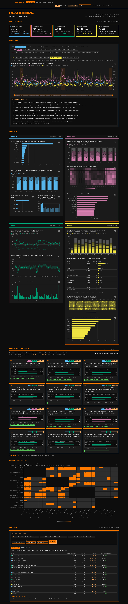

# SelfScope

**A privacy-first personal data dashboard.** Drop in your own exports — UPI/SBI bank statements,
WhatsApp chats, Spotify listening history, YouTube watch history (Google Takeout) — and get one
interactive dashboard with insights *across* apps: "on days with 24+ YouTube videos you're 3.2x as likely
to order food delivery", "sad songs peak around 2 am", "during exams your negative messages triple".

**Everything runs in your browser. Your data never leaves your device**: no server, no uploads, no
analytics. The only network requests are for static code (the Python runtime, fonts).



*(Data Science & Visualisation course project. All screenshots use the synthetic demo data.)*

## Architecture

```
your export files ──► Import screen (detects the source, unzips)
                        │
                        ▼
   Pyodide (Python in a Web Worker): parsers → one shared event table
                        │                     (docs/schema.md)
                        ▼
   DuckDB-WASM (SQL in the browser): events + views, saved as Parquet in IndexedDB
                        │
        ┌───────────────┼──────────────────────────────┐
        ▼               ▼                              ▼
  spend categoriser   enrichment                 analysis engine
  (ML model trained   (video topics, song moods,  (Spearman + FDR, calendar control,
   offline, run in     message sentiment)          periods, anomalies)
   the browser)                                     │
                                                    ▼
                         Dashboard (React + Apache ECharts)
```

- `web/` — Vite + React + TypeScript + Tailwind. Python modules in `web/src/python/`, all SQL in `web/src/sql/`.
- `ml/` — offline training and evaluation (spend categoriser, sentiment evaluation, analysis validation).
- `data/samples/` — a synthetic demo year in the real export formats; `data/private/` — your real exports
  (git-ignored, never committed).
- `docs/` — design system (`design.md`), event schema (`schema.md`), analysis methods (`analysis.md`),
  known gaps (`backlog.md`). Developer notes: `CLAUDE.md`.

## Run it

Needs Node 22 (LTS) or newer.

```bash
cd web
npm install
npm run dev
```

Open http://localhost:5173. Production build: `npm run build` (output in `web/dist/`, a static site).

### Load the demo

1. Click **IMPORT** → **★ LOAD DEMO DATA**. This switches to the separate **DEMO** database and imports
   one synthetic year (Spotify, YouTube, 5 WhatsApp chats, an SBI statement), tags the three exam periods
   and picks the demo user's chat name.
2. The first time, the browser downloads the Python runtime and its packages (tens of MB from the jsDelivr CDN, cached afterwards) and analyses the
   data in a worker (about 15 s for the first analysis, then cached).
3. Open **DASHBOARD**. Use the date-range picker (or drag the timeline slider), click any day for the
   drill-down, click an insight card for its scatter plot, and try **Control for weekday + tagged periods**.

Your own files go in **MY DATA**, a separate database that never mixes with the demo.

## Tests and reports

```bash
cd web/src/python && ../../../.venv/bin/python -m pytest   # parsers, SQL, enrichment, analysis, dashboard SQL
cd ml && ../.venv/bin/python -m pytest                     # ML pipeline
```

(Python setup: `web/src/python/README.md`.)

| Report | What |
|---|---|
| `docs/analysis.md` | how the insights are computed, why, validation on the demo, limits |
| `ml/reports/` | spend categoriser evaluation, sentiment accuracy (`sentiment_report.md`), analysis validation (`analysis_validation.json`) |
| `ml/notebooks/01_spend_categoriser.ipynb` | categoriser training walkthrough |
| `docs/screenshots/` | dashboard screenshots (demo data) |
