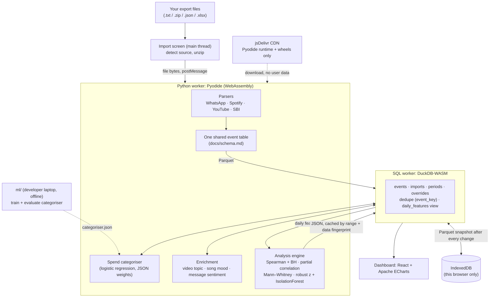

# SelfScope — viva notes

All numbers are on the **synthetic demo year** (17 Nov 2025 – 16 Nov 2026, generated with `--seed 42`) and come
from the reports in `ml/reports/` (re-run commands at the end).

## 1. One-minute pitch

Every app already lets you download your own data: WhatsApp chats, Spotify history, YouTube history, bank
statements. But each export is a raw file nobody reads, and no app can see the others. **SelfScope** turns those
files into one dashboard and looks for patterns *across* apps: "on days with 24+ YouTube videos you're 3.2x as likely
to order food delivery", "sad songs peak at 2 am", "during exams your negative messages nearly triple".

The twist is privacy: **everything runs in your browser**. Python (pandas, scikit-learn) and a SQL database (DuckDB)
run inside the tab as WebAssembly; there is no server, and a Content-Security-Policy makes the browser itself refuse
to send anything anywhere except to download the Python runtime. The data-science part is honest statistics:
rank correlations with false-discovery control, a check for whether a link survives once the calendar (weekday,
exams, breaks) is removed, period comparisons, anomaly detection, and an ML spend categoriser trained offline and
evaluated on a held-out statement (macro-F1 0.97). "Association, not causation" is printed on every finding.

## 2. Architecture



## 3. Methods in 2–3 lines each

- **Parsers** (`web/src/python/parsers/`). Each export format is read into one event table (one row per message,
  play, video or transaction, UTC timestamps + Asia/Kolkata local fields). WhatsApp: Android/iOS line formats,
  system lines and media placeholders. SBI: finds the "Txn Date" header, **never stores the header block**, masks
  9+ digit numbers (except the 12-digit UPI reference used for dedupe).
- **Dedupe** (`src/sql/import.sql`). Each event gets `event_key = md5` of the fields that identify it (e.g. bank:
  date, UPI ref, amount, running balance); a row is inserted only if its key is new, so re-importing or an
  overlapping newer export adds only new events. Identical files are skipped by SHA-256; Spotify's two export
  formats are reconciled with a 60-second rule.
- **Spend categoriser** (`ml/`). Logistic regression on TF-IDF character n-grams of the (truncated) payee name +
  rule flags + amount + *payee behaviour* (how often, how much, how regular). Trained on 23.7k synthetic debits;
  cross-validated with GroupKFold by payee (unseen payees); tested once on the demo statement. Exported as plain
  JSON weights and run in the browser.
- **Sentiment** (`src/python/enrich/sentiment.py`). A VADER-style lexicon scorer (English word list + Hinglish words
  + emojis) with negation (also Hindi "accha nahi"), boosters, "but/lekin" and caps. Explainable and tiny; only
  your own messages feed your mood metrics; the dashboard never shows message text.
- **Spearman + Benjamini–Hochberg** (`analysis/correlations.py`). For every pair of daily metrics from different
  apps, at lags 0/1/2 days: Spearman rank correlation (robust to skew and outliers), then BH correction over all
  1,170 tests (5% false-discovery rate). Reported: q < 0.05 and |rho| ≥ 0.2; "weaker signals" 0.1–0.2.
- **Partial correlation / calendar control** (`analysis/calendar_control.py`). Rank each metric, remove its
  weekday means and in/out-of-period means (Exams, Breaks) with a small linear model, correlate the residuals;
  BH over all tests again (strict). Tells whether a link is more than "both follow the calendar".
- **Periods** (`analysis/periods.py`). Days inside a tagged period (or weekends) vs outside, per metric:
  Mann–Whitney U test (no normality assumption) + BH, reported as % change and rank-biserial effect size.
- **Anomalies** (`analysis/anomalies.py`). Robust z-score per metric (median and MAD, |z| > 3.5) plus an
  IsolationForest on the whole day (2% of days) for unusual *combinations*; each flagged day is explained by
  its 2–3 most extreme metrics.

## 4. Key numbers

| What | Number | Source |
|---|---|---|
| Demo data | 11,761 plays · 7,378 videos · 19,532 messages (5 chats) · 2,629 bank rows | `analysis_validation.json` |
| **Categoriser, test** (demo statement, never used in training) | **accuracy 96.2%, macro-F1 0.965** (2,565 debits) | `categoriser_report.md` |
| Categoriser, cross-validation (GroupKFold by payee) | accuracy 0.905, **macro-F1 0.804 ± 0.028** | same |
| Baselines (test macro-F1) | rules only 0.841 · text only 0.814 | same |
| **Sentiment** vs always-neutral baseline | **accuracy 79.2%, macro-F1 0.79** vs 47.0% / 0.21 | `sentiment_report.md` |
| Correlation tests | 1,170 (25 metrics, cross-app pairs, lags 0–2) | `analysis_validation.json` |
| Raw findings | **40 insights** + 62 weaker signals | same |
| **Null test** (dates shuffled, 40 runs) | **0 false insights**; 1.5 false weaker signals per run | same |
| Planted patterns found | all, except exam late-night YouTube (up 4 points, not significant) | `docs/analysis.md` §6 |
| **Calendar control: weekday + Exams** | 0 hold, **12 borderline**, 13 unconfirmed, 15 fade; YouTube→food q = 0.056 (borderline) | `analysis_validation.json` → `calendar_control` |
| **Calendar control: weekday + Exams + Breaks** | 0 hold, 0 borderline, 3 unconfirmed, 37 fade; no new "two days later" links | same |
| Privacy audit | the app contacts only its own site and `cdn.jsdelivr.net` (Python runtime): all GET, no request bodies; importing a file makes no request at all | `docs/privacy.md` |
| Speed | first analysis ~15–30 s on a cold start (Python download); cached afterwards; 30-day range ~2 s | browser checks |

**How to read the calendar-control result.** The raw 40 insights are mostly calendar-driven: exams and semester
breaks move many habits together. Once weekday, exams *and* breaks are removed, nothing passes the strict
correction. The strongest remaining link is the one planted as a direct effect (YouTube videos → food delivery,
partial rho 0.18, p = 0.0005, the smallest of 1,170 p-values), but among 1,170 tests about 12 p-values below 0.01 are
expected by chance (we see 12), so BH gives it q = 0.58: real, but not provable from one year of data with this many
tests. That is the honest answer, and it is why the dashboard labels findings "association, not causation".

## 5. Limitations (stated honestly)

1. **Synthetic data.** The patterns found are the ones planted; real life is noisier, and real accuracy of the
   categoriser and the sentiment scorer is unknown (both were evaluated on data written by the same person who
   designed the features / lexicon).
2. **Confounding.** Most cross-app links are calendar effects. Calendar control removes weekday and tagged periods
   only; untagged ones (festivals, start of month, illness) remain.
3. **Multiple testing vs power.** 1,170 tests with BH protects against false findings (0 in the null test) but can
   hide small real effects (the planted YouTube→food link after calendar control).
4. **Time-series dependence.** Neighbouring days are similar; p-values assume independent days, so they are a bit
   optimistic. The null test is the practical check.
5. **Enrichment coverage.** Song moods and video topics come from curated lists that cover the demo 100% by
   construction; real libraries will have many "unknown" songs/channels (never guessed).
6. **Sentiment is a lexicon**: misses sarcasm, slang ("dead 💀" = funny), Hindi false friends ("baad").
7. **Formats.** SBI only (Excel, not PDF); English-language WhatsApp exports; YouTube watch time is estimated from
   gaps between videos (Takeout has no durations).
8. **One browser.** Data lives in this browser's storage only; no sync, and two open tabs can overwrite each other.

## 6. Likely questions

1. **Why Spearman and not Pearson?** Daily data is skewed (most days ₹0 food delivery) with outliers. Spearman uses
   ranks, so one extreme day can't create or hide a link, and it catches any monotonic "more X, more Y" pattern.
2. **Why Benjamini–Hochberg and not Bonferroni?** With 1,170 tests, p < 0.05 alone gives ~58 false findings.
   Bonferroni controls the chance of *any* false finding and would hide most real effects; BH controls the
   *proportion* of false findings among those reported (5%), a better trade-off for exploration.
3. **How do you know the insights aren't noise?** The null test: shuffle one app's dates (breaking real links but
   keeping its values) and re-run, 40 times. 0 false insights in the reported tier; ~1.5 false weaker signals per
   run, which is why that tier is labelled "may be chance".
4. **Correlation isn't causation; what do you do about it?** Every finding says so; period comparisons show the
   common cause directly (exams); calendar control removes weekday/exam/break effects and shows most links vanish.
5. **What is partial correlation here?** Correlation of what's left after removing each metric's weekday and
   period averages (on ranks, so it's a partial Spearman). If two habits only move together because of exams,
   the residuals don't correlate.
6. **Why does the planted YouTube→food link become "unconfirmed"?** Its size barely changes (0.19 → 0.18), but the
   evidence needed rises: among 1,170 tests a single p of 0.0005 isn't enough under BH once nothing else is real.
   With exams only it is borderline (q 0.056). This is a power limitation, shown honestly rather than tuned away.
7. **How was the categoriser validated without leakage?** Training data is synthetic with its own name lists and
   year; CV groups by payee (a payee never appears in train and validation); the demo statement is used once, at
   the end, and a test checks that no demo payee name appears in training.
8. **Why logistic regression and not a bigger model?** Small data, must run in the browser, must be exportable as
   JSON (no pickle), and interpretable; with the behaviour features it reaches 0.97 macro-F1 on the test set.
9. **Why a lexicon for sentiment instead of a transformer?** A transformer would add tens of MB of model download and
   seconds per thousand messages in the browser, and is trained on English, not Hinglish. The lexicon is tiny,
   explainable (every score shows the words it matched) and handles Hinglish negation. 79% vs 47% baseline.
10. **How does Python run in a browser?** Pyodide: CPython compiled to WebAssembly, with pandas/scipy/scikit-learn
    wheels, inside a Web Worker so the UI never freezes. The same `.py` files run in CPython for the tests.
11. **Why DuckDB?** A real analytical SQL engine in WebAssembly: window functions, UNPIVOT, Parquet in/out. All SQL
    lives in `.sql` files and is tested with the DuckDB Python package, so the browser and tests run the same queries.
12. **Can you prove no data is uploaded?** The privacy audit recorded every request in a fresh browser (`docs/privacy.md`):
    only GETs to this site and to the Python CDN, no request bodies. And a Content-Security-Policy makes the browser
    block connections to any other host, even if code tried.
13. **What if I import the same file twice, or a newer export?** File hash → skipped; overlapping exports → only
    events with new `event_key`s are added (tests cover each source).
14. **How are anomalies detected?** Robust z (median/MAD, not mean/std, so outliers don't hide themselves) per metric,
    plus IsolationForest for odd combinations; each flagged day is explained in words.
15. **What would you do next?** Test on consenting real users' data (accuracy is unknown on real data), a
    block-bootstrap for time dependence, logistic regression for rare outcomes like food delivery, more banks and
    PDF statements, and a residual scatter for controlled links.

## Re-run the numbers

```bash
.venv/bin/python ml/scripts/train_categoriser.py     # ml/reports/categoriser_report.md
.venv/bin/python ml/scripts/eval_sentiment.py        # ml/reports/sentiment_report.md
.venv/bin/python ml/scripts/validate_analysis.py     # ml/reports/analysis_validation.json (incl. calendar_control, null_test)
```
