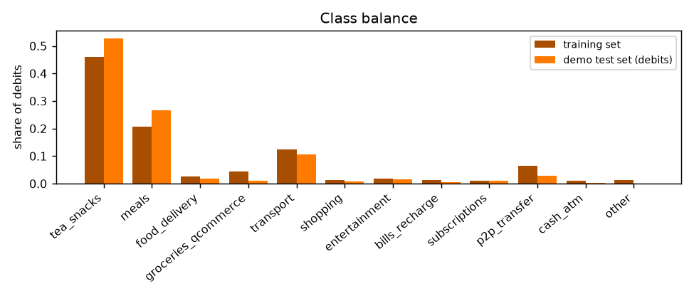
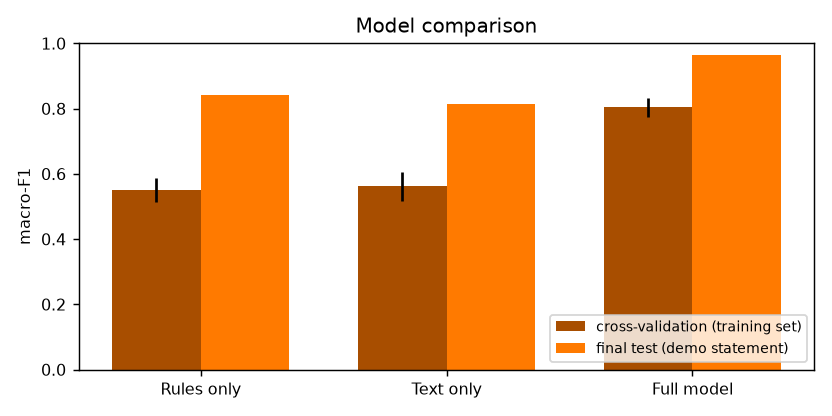
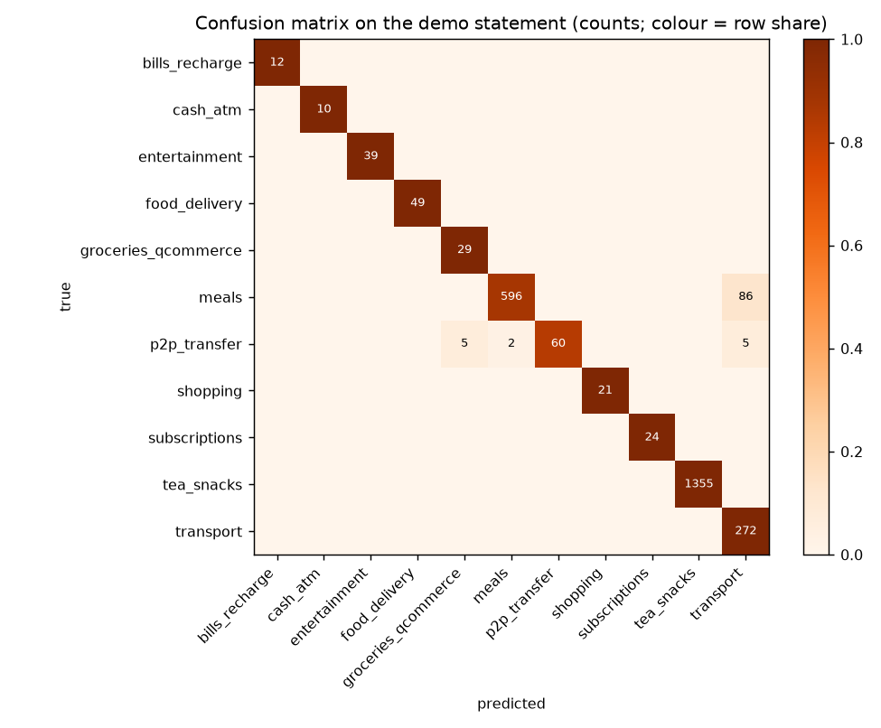
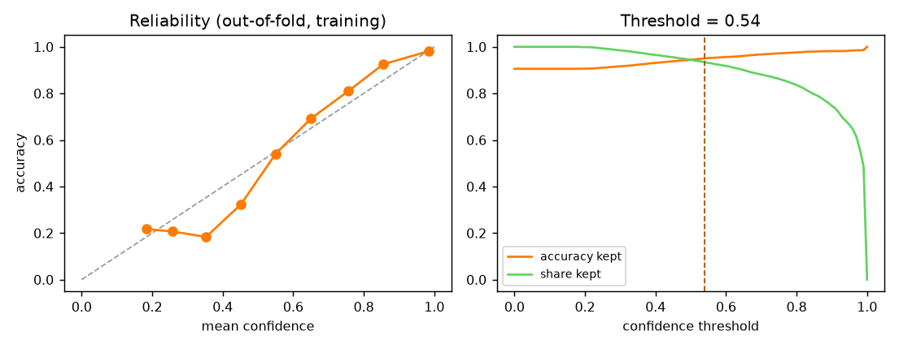

# Spend categoriser — report

Model v1.0 · trained 2026-11-23 · scikit-learn 1.8.0 · generated by `ml/scripts/train_categoriser.py` (numbers below are filled in automatically).

## 1. What it does

Every **debit** in a bank statement gets one of 12 categories: tea_snacks, meals, food_delivery, groceries_qcommerce, transport, shopping, entertainment, bills_recharge, subscriptions, p2p_transfer, cash_atm, other. **Credits** are always `income` (a rule, not the model). ATM withdrawals are always `cash_atm` (rule). Everything runs in the browser; no transaction leaves the device.

The hard part: SBI cuts payee names to ~8 characters (`MAIN CAN`, `SRI LAKS`) and most small vendors and people have names the model has never seen. So besides the text, the model looks at **behaviour**: a payee you pay ₹25 several times a day is almost certainly a tea stall, whatever its name.

## 2. Data — training and test are independent

- **Training set:** 23,692 synthetic debits from 12 synthetic users (611 distinct payees), made by `ml/scripts/make_training_set.py` from a hand-written list of 434 real Indian merchants/brands plus 20 UPI handle patterns (`ml/data/merchant_labels.csv`), and synthetic tea stalls, canteens, auto drivers and friends with **their own name lists, random stream and year (2024)**.
- **Test set:** the demo SBI statement (`data/samples/bank/SBI_statement_demo.xlsx`, 2,565 debits) with its answer key `ml/data/demo_bank_truth.csv`. It was **never** used for training, feature design or choosing hyper-parameters — only for the final numbers below. A test checks that no demo vendor or person name appears in the training data. Real brands (Swiggy, Zomato, …) appear in both, as they would in real life.
- Both are realistic, not balanced: tea/snack and meal payments dominate (see chart).



## 3. Features (`ml/selfscope_ml/features.py`, shared with the browser)

| Group | What | Why |
|---|---|---|
| Text | character 2–5-grams of payee name + UPI ID + note (digits → 0), bank code and channel as tokens; TF-IDF | handles truncated names (`SWIGGY`, `swiggy.sto`) |
| Rule flags | channel one-hot, person-like UPI ID, phone-number UPI ID, shop QR handle (`paytmqr…`, `q…@ybl`), keyword-dictionary category | cheap, strong signals |
| Amount | log amount, round-number flags, amount buckets | ₹25 vs ₹450 vs ₹2,000 |
| Payee behaviour | over the whole statement, per payee: number of payments, payments per active day, median and spread of the amount, weekend share, regularity, this amount vs. the payee's usual | recognises routines when the name is unknown |

## 4. Models compared

Cross-validation: 5-fold **GroupKFold by payee** on the training set, so a payee is never seen in training and validation at the same time (this measures how well the model handles *new* payees). Logistic regression; C and class weighting picked by cross-validated macro-F1 only.

| Model | CV accuracy | CV macro-F1 | Test accuracy | Test macro-F1 |
|---|---|---|---|---|
| a) Rules only (keyword dictionary + channel rules) | 0.519 | 0.551 ± 0.036 | 0.729 | 0.841 |
| b) Text only (TF-IDF + logistic regression) | 0.642 | 0.562 ± 0.044 | 0.802 | 0.814 |
| c) **Full model** (text + rule flags + amount + payee behaviour) | 0.905 | 0.804 ± 0.028 | 0.962 | 0.965 |

Chosen settings: `full C=0.5 cw=balanced` (full), `text C=8.0 cw=balanced` (text only).



## 5. Final test on the demo statement

- **Accuracy 96.2%**, **macro-F1 0.965** on 2,565 debits (macro-F1 averages the F1 of every category equally, so small categories count as much as tea).
- Credits: 64 rows, all `income` by rule (100% correct).
- Payees with a known brand/keyword (28% of debits): accuracy 100.0%. Unknown local payees and people: 94.7%.
- With the confidence threshold applied (low-confidence → `other` + REVIEW): accuracy 95.4%, macro-F1 0.969.

| Category | Precision | Recall | F1 | Support |
|---|---|---|---|---|
| bills_recharge | 1.00 | 1.00 | 1.00 | 12 |
| cash_atm | 1.00 | 1.00 | 1.00 | 10 |
| entertainment | 1.00 | 1.00 | 1.00 | 39 |
| food_delivery | 1.00 | 1.00 | 1.00 | 49 |
| groceries_qcommerce | 0.85 | 1.00 | 0.92 | 29 |
| meals | 1.00 | 0.87 | 0.93 | 682 |
| p2p_transfer | 1.00 | 0.83 | 0.91 | 72 |
| shopping | 1.00 | 1.00 | 1.00 | 21 |
| subscriptions | 1.00 | 1.00 | 1.00 | 24 |
| tea_snacks | 1.00 | 1.00 | 1.00 | 1355 |
| transport | 0.75 | 1.00 | 0.86 | 272 |



**Most common confusions** (true → predicted):

- meals → transport: 86
- p2p_transfer → groceries_qcommerce: 5
- p2p_transfer → transport: 5
- p2p_transfer → meals: 2

**Errors by payee** — most mistakes come from very few payees, because the model decides per payee pattern (all payments to one canteen look alike):

- `annapoor|annapoorna`: 71 wrong
- `dakshin|dakshinmes`: 13 wrong
- `rohan ku|rohank98@o`: 4 wrong
- `varun ra|varunrao@o`: 3 wrong
- `karthik|karthik.s@`: 3 wrong

The largest one is a canteen whose UPI ID (`annapoornamess@…`) is cut by SBI to `annapoorna`: without the word *mess* it looks like a person's name, and in the training data name-like IDs with small, regular, fixed amounts were mostly auto drivers. The training data has few shops with long names whose shop word gets cut off. **We did not change the training data after seeing this**, because that would tune the model on the test set and make the test number dishonest. In the app, one correction with "apply to all payments to this payee" fixes every such row; the next model version should add such shops to the training data and be evaluated on a new, unseen test statement (see `docs/backlog.md`).

## 6. Confidence threshold and REVIEW

The model's top probability is used as its confidence. On out-of-fold predictions (training set), the smallest threshold where the kept predictions are at least 95% accurate is **0.54**; it keeps 93.4% of them. Below it, the app shows the category as `other` and lists the transaction under **REVIEW** for the user to fix.
On the demo statement **57 of 2,565 debits (2.2%)** fall below the threshold. By true category: meals 38, p2p_transfer 19.



## 7. Error analysis — 15 mistakes

| Date | Payee | UPI ID | ₹ | True | Predicted | Conf. | Why it went wrong |
|---|---|---|---|---|---|---|---|
| 2026-05-26 | `VARUN RA` | `varunrao@o` | 60 | p2p_transfer | transport | 0.82 | a friend paid repeatedly (31 payments, median ₹220, 1.0 per active day); the amounts look like a transport payee's and nothing in the name says 'person' |
| 2026-10-31 | `ANNAPOOR` | `annapoorna` | 100 | meals | transport | 0.81 | UPI ID 'annapoorna' has no shop word (SBI keeps only 10 characters), so it looks like a person's name, like the auto drivers paid to name-like IDs in training; 116 payments, median ₹115, 1.0 per active day |
| 2025-12-28 | `UDUPI GR` | `udupigrand` | 100 | meals | transport | 0.66 | UPI ID 'udupigrand' has no shop word (SBI keeps only 10 characters), so it looks like a person's name, like the auto drivers paid to name-like IDs in training; 32 payments, median ₹120, 1.0 per active day |
| 2026-10-30 | `DAKSHIN` | `dakshinmes` | 100 | meals | transport | 0.54 | UPI ID 'dakshinmes' has no shop word (SBI keeps only 10 characters), so it looks like a person's name, like the auto drivers paid to name-like IDs in training; 91 payments, median ₹115, 1.0 per active day |
| 2026-10-24 | `PRIYA SH` | `priyasharm` | 480 | p2p_transfer | groceries_qcommerce | 0.52 | a friend paid repeatedly (14 payments, median ₹200, 1.0 per active day); the amounts look like a groceries qcommerce payee's and nothing in the name says 'person' |
| 2026-06-03 | `ISHITA R` | `ishita.r@o` | 210 | p2p_transfer | meals | 0.44 | a friend paid repeatedly (2 payments, median ₹225, 1.0 per active day); the amounts look like a meals payee's and nothing in the name says 'person' |
| 2026-07-11 | `ROHAN KU` | `rohank98@o` | 80 | p2p_transfer | transport | 0.38 | a friend paid repeatedly (13 payments, median ₹230, 1.0 per active day); the amounts look like a transport payee's and nothing in the name says 'person' |
| 2026-08-29 | `ROHAN KU` | `rohank98@o` | 370 | p2p_transfer | groceries_qcommerce | 0.35 | a friend paid repeatedly (13 payments, median ₹230, 1.0 per active day); the amounts look like a groceries qcommerce payee's and nothing in the name says 'person' |
| 2026-10-17 | `KARTHIK` | `karthik.s@` | 410 | p2p_transfer | groceries_qcommerce | 0.20 | a friend paid repeatedly (11 payments, median ₹410, 1.0 per active day); the amounts look like a groceries qcommerce payee's and nothing in the name says 'person' |
| 2026-03-14 | `KARTHIK` | `karthik.s@` | 430 | p2p_transfer | transport | 0.20 | a friend paid repeatedly (11 payments, median ₹410, 1.0 per active day); the amounts look like a transport payee's and nothing in the name says 'person' |
| 2026-08-16 | `KARTHIK` | `karthik.s@` | 220 | p2p_transfer | meals | 0.19 | a friend paid repeatedly (11 payments, median ₹410, 1.0 per active day); the amounts look like a meals payee's and nothing in the name says 'person' |
| 2026-05-29 | `ANNAPOOR` | `annapoorna` | 100 | meals | transport | 0.81 | UPI ID 'annapoorna' has no shop word (SBI keeps only 10 characters), so it looks like a person's name, like the auto drivers paid to name-like IDs in training; 116 payments, median ₹115, 1.0 per active day |
| 2025-12-27 | `UDUPI GR` | `udupigrand` | 100 | meals | transport | 0.66 | UPI ID 'udupigrand' has no shop word (SBI keeps only 10 characters), so it looks like a person's name, like the auto drivers paid to name-like IDs in training; 32 payments, median ₹120, 1.0 per active day |
| 2026-10-20 | `DAKSHIN` | `dakshinmes` | 100 | meals | transport | 0.54 | UPI ID 'dakshinmes' has no shop word (SBI keeps only 10 characters), so it looks like a person's name, like the auto drivers paid to name-like IDs in training; 91 payments, median ₹115, 1.0 per active day |
| 2026-02-15 | `VARUN RA` | `varunrao@o` | 480 | p2p_transfer | transport | 0.37 | a friend paid repeatedly (31 payments, median ₹220, 1.0 per active day); the amounts look like a transport payee's and nothing in the name says 'person' |

## 8. Limitations

- **Synthetic data on both sides.** Training rows are generated from a merchant list and simulated habits; the test statement is also generated (from a real student routine). Real-world accuracy on real statements is **unknown** and probably lower — real narrations are messier and real people's habits vary more.
- **Truncated names.** SBI keeps ~8 characters of the payee; different shops can collide, and a brand the model never saw is only recognised by its behaviour.
- **Labelling conventions** decide some 'errors': sit-down cafe chains are `entertainment`, a canteen is `meals`, a tea stall is `tea_snacks`, friends paying back are `income`. Someone else might label differently.
- **Autos paid to phone numbers** look exactly like friends; only the fixed small fare separates them.
- **Behaviour features need history.** A payee seen once has no routine to learn from.
- **Test score is higher than cross-validation** because the demo statement is a tidy, regular routine with many well-known brands, while cross-validation holds out whole payees (including brands) the model has never seen. The cross-validation number is the more cautious estimate for a new user.
- Only SBI narrations are handled (see `docs/backlog.md`).

## 9. How to retrain

```bash
# from the repo root, with the venv from web/src/python/README.md + ml/requirements.txt
.venv/bin/python ml/scripts/make_training_set.py     # ml/data/training_set.csv
.venv/bin/python ml/scripts/train_categoriser.py     # CV, test, export, this report
cd ml && ../.venv/bin/python -m pytest                # pipeline + parity tests
```

To change the categories or features: edit `ml/selfscope_ml/` (the browser copy is synced by `web/scripts/sync-ml.mjs`), bump `FEATURE_VERSION` / `MODEL_VERSION`, retrain. The app re-categorises stored bank rows automatically when the model version changes; user overrides are kept.

## 10. Reproducibility

- Seeds: training set `train:2027`; demo data `--seed 42` (separate bank stream).
- Versions: scikit-learn 1.8.0, numpy 2.4.6, pandas 3.0.2 (same as Pyodide 314.0.8).
- Export: `web/public/models/categoriser.json` (1,900 KB, plain JSON, no pickle). The browser inference (`web/src/python/categoriser.py`) matches sklearn's `predict_proba` to **2.8e-09** (max absolute difference) on every demo debit.
- Full pipeline run time: 198 s.
