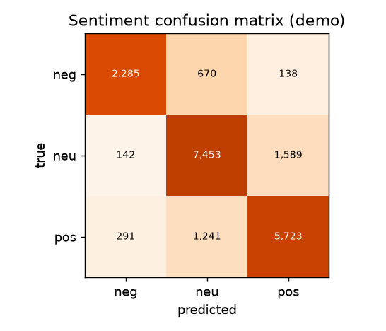

# WhatsApp sentiment scorer — evaluation

Scorer: `web/src/python/enrich/sentiment.py` — VADER-style rules over VADER's English lexicon plus a hand-curated Hinglish lexicon and emojis (`web/public/data/sentiment_lexicon.json`). No training, so the whole demo is a test set. Generated by `ml/scripts/eval_sentiment.py`.

Test set: every text message of the 5 demo chats with its true label from `ml/data/demo_whatsapp_truth.csv` (the label of the positive / neutral / negative pool the demo generator drew the message from).

## Results

| Messages | n | Accuracy | Macro-F1 |
|---|---|---|---|
| All text messages | 19,532 | 0.792 | 0.789 |
| Only the user's own (Amogh) — used for the user's mood | 8,025 | 0.789 | 0.788 |
| Distinct texts (each wording once) | 194 | 0.768 | 0.770 |
| Baseline: always 'neutral' | 19,532 | 0.470 | 0.213 |

| Label | Precision | Recall | F1 | Support |
|---|---|---|---|---|
| neg | 0.84 | 0.74 | 0.79 | 3,093 |
| neu | 0.80 | 0.81 | 0.80 | 9,184 |
| pos | 0.77 | 0.79 | 0.78 | 7,255 |

## Most frequent mistakes (with what the scorer matched)

| Message | True | Predicted | Score | Matched words (valence) | Times in demo |
|---|---|---|---|---|---|
| ok | neu | pos | +0.30 | ok +1.2 | 211 |
| tell me when you're free | neu | pos | +0.51 | free +2.3 | 184 |
| acha | neu | pos | +0.25 | acha +1.0 | 182 |
| abhi nahi, baad me | neu | pos | +0.43 | baad +1.9 | 175 |
| okk | neu | pos | +0.30 | okk +1.2 | 169 |
| free ho? | neu | pos | +0.51 | free +2.3 | 168 |
| reached | neu | pos | +0.10 | reached +0.4 | 166 |
| finally weekend!! | pos | neu | +0.00 | (nothing matched) | 164 |
| hahaha dead 💀 | pos | neg | -0.18 | hahaha +2.6, dead -3.3 | 160 |
| you made my day | pos | neu | +0.00 | (nothing matched) | 152 |
| let's gooo | pos | neu | +0.00 | (nothing matched) | 148 |
| trip photos!!! | pos | neu | +0.00 | (nothing matched) | 107 |

## Caveats (read before quoting the numbers)

- **Optimistic:** the demo messages come from a few hundred fixed phrases, and the same person wrote the demo generator and the Hinglish lexicon. Real chats are far more varied (spelling, slang, sarcasm, code-mixing), so expect lower accuracy on real data.
- **Lexicon limits:** words outside the lexicons count as neutral; sarcasm and context are invisible; Gen-Z usage like "dead 💀" (= very funny) reads as negative because VADER scores *dead* at -3.3.
- The lexicon was written before this evaluation was run and was **not tuned on its results**.

Re-run: `python ml/scripts/eval_sentiment.py`
